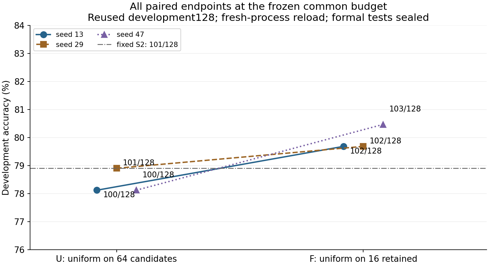
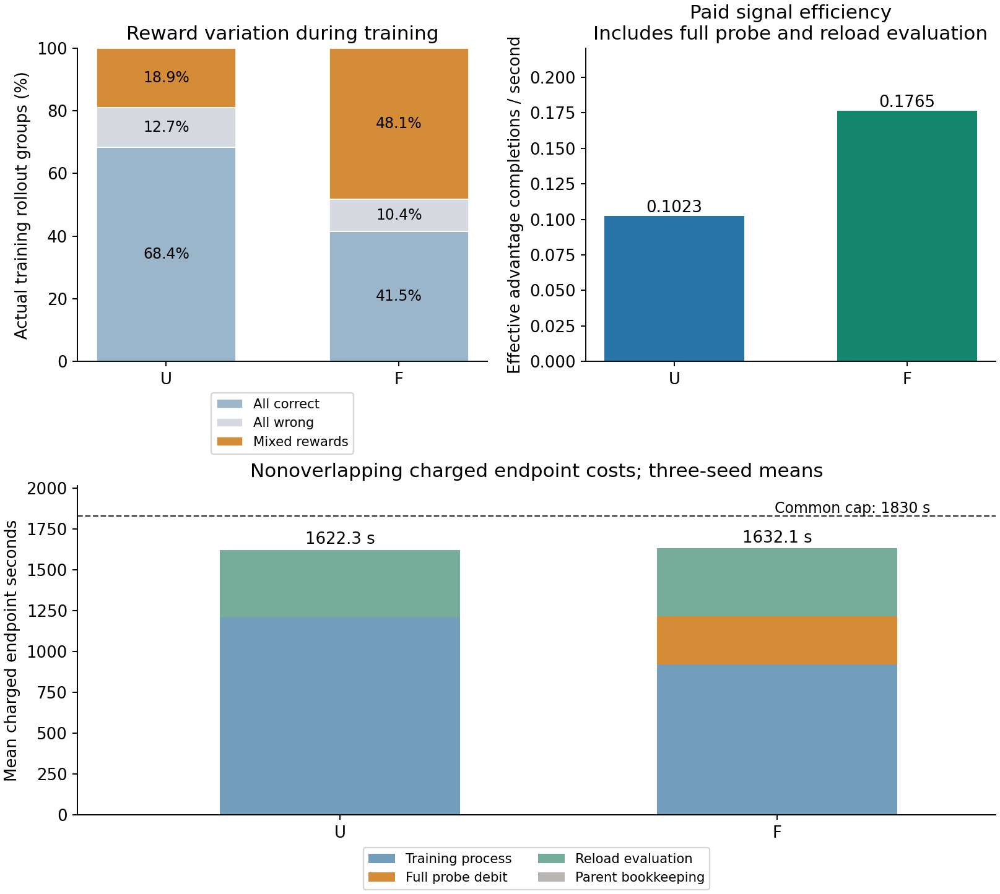

# ReasoningRL Lab：固定 S2 预筛后均匀采样的受控开发实验

**固定预筛明显提高了有效训练信号，三个种子的开发正确数均高于全池均匀；稳定的推理泛化收益仍未建立。** U/F 的开发准确率三种子均值为 **78.385% / 79.948%**，F−U 配对差均值 **+1.5625 个百分点**。共同真实S2本机独立重载为 101/128。所有六个终点从新进程加载并完成同一冻结开发128题评测；GSM8K test/SVAMP保持封存。

## 三种子真实终点与主要判断

|seed|U正确 /128|F正确 /128|F−U百分点|
|---|---:|---:|---:|
|13|100|102|+1.5625|
|29|101|102|+0.7813|
|47|100|103|+2.3438|

三种子配对差依次为 +1.5625、+0.7813、+2.3438pp，样本标准差 0.781pp。固定这三个种子、按同题联合重采样的描述性95% bootstrap区间为 [-0.781, +4.167]pp。这不是种子不确定性或正式泛化区间，三个种子和同一128题的384个相关配对不能当作384道独立问题。validation内的近重复簇也可能违反逐题独立近似。沿用confirmation128是已经使用过的开发数据。

[三种子配对差CSV](paired_differences.csv) · [结构化原始汇总](summary.json)。

共同S2为101/128（78.906%）。F相对S2的三种子均值只高1.042pp，U相对S2低0.521pp；组间差异的一部分是F保留了U发生回归的能力。三种子正向一致是本固定开发范围内的真实结果，条件题目bootstrap区间仍跨零，单一候选池、单一探测种子和重复使用的开发题都限制外推。不能把本轮写成正式测试提升，或仅凭答案正确数证明推理过程更可靠。

## 机制、有效信号与真实更新

|组别|全对 /全错 /混合组|零方差组比例|非零梯度步 /优化步|有效优势completion|含探测与重载评测的有效completion/秒|
|---|---|---:|---|---:|---:|
|U|456 /85 /126|81.109%|126 /667|498|0.10233|
|F|188 /47 /218|51.876%|218 /453|864|0.17646|

机制按预期改变：F在付出完整初始探测成本后，仍获得864条有效优势completion和218个非零梯度步骤，U分别为498条和126步；包含独立评测的有效样本/秒提高72.45%。这不是通过修改学习率、模型、G4、温度、奖励或跳过零梯度Adam步骤取得的。U三种子实际覆盖64/63/63题，F均为16题；更密的信号与更窄的题目覆盖同时存在。两臂训练题上的随机采样成功率分别为79.685%和69.812%，它们受不同选题分布及训练轨迹影响，不能替代共同开发集的greedy准确率。

U的有效completion/付费训练链路秒为 0.13729，非零梯度步/含评测端到端秒为 0.02589；541个零梯度步中，527步仍实际改变参数。

U零优势completion为2164/2668（81.109%），截断屏蔽为10/2668，其中6条原有非零优势；零梯度optimizer step为541/667（81.109%）。组、completion和optimizer step为不同口径；本配置一组对应一步已由实际日志核验。

F的有效completion/付费训练链路秒为 0.23715，非零梯度步/含评测端到端秒为 0.04452；235个零梯度步中，231步仍实际改变参数。

F零优势completion为940/1812（51.876%），截断屏蔽为11/1812，其中8条原有非零优势；零梯度optimizer step为235/453（51.876%）。组、completion和optimizer step为不同口径；本配置一组对应一步已由实际日志核验。

[逐题训练曝光](item_exposure.csv)保留实际覆盖与重复采样次数。

F的首/末四分之一混合组比例依次为41.7%→52.8%、42.9%→57.1%、46.3%→48.8%，未观察到训练信号系统性枯竭。U在初始K4全对/全错、按F规则会被排除的题上，仍得到151/498（30.3%）有效优势completion；有限K的极端计数不等于真实成功率恰为0或1。这说明固定筛选存在覆盖损失，但不能从U轨迹推断F在这些题上的反事实收益。当前数据不支持把动态过滤当成必然更优的下一步。

[实际信号首尾四分之一](signal_drift.json)与[U中被初始探测排除题的训练信号](screened_out_training_signal.json)只描述各自真实轨迹；不能把U上的信号当作F未发生的反事实结果。

## 端到端成本、token与异常

|终点|优化步|训练进程秒|F探测扣费秒|独立评测秒|付费端到端秒 /共同1830秒上限|训练生成token|截断 /解析失败completion|
|---|---:|---:|---:|---:|---:|---:|---|
|U-s13|225|1209.78|0.00|412.25|1622.36|132009|4 /23（分母900）|
|F-s13|145|917.92|292.83|426.65|1637.72|89607|3 /8（分母580）|
|U-s29|220|1207.74|0.00|421.01|1629.06|131626|3 /12（分母880）|
|F-s29|143|928.23|292.83|423.79|1645.53|90436|5 /15（分母572）|
|U-s47|222|1209.26|0.00|405.76|1615.34|134073|3 /15（分母888）|
|F-s47|165|917.70|292.83|402.14|1612.98|99138|3 /15（分母660）|

所有行的训练进程包含启动、加载、缓存核验、采样、前后向、优化与保存；评测进程包含独立加载、greedy生成与落盘，外围核验也计入端到端列。F每行额外扣完整292.832841秒探测；物理共享探测只执行一次，各F的97.610947秒摊销仅作成本解释，没有一套假想的额外训练结果。原子rollout/optimizer边界造成的训练额度小幅超额与共同上限未用足均保留在CSV，评测剩余额度不回填。

U三终点训练生成 397708 token，独立评测生成 54816 token；单终点口径分配的探测token合计 0，含重复分配的总token为 452524。

F三终点训练生成 279181 token，独立评测生成 54911 token；单终点口径分配的探测token合计 116043，含重复分配的总token为 450135。

实际完整探测只生成 38681 token；探测解析失败4条、截断0条，分母256。全部六个开发终点评测解析失败合计25条、截断12条，分母768。

全会话所有已落盘输出的物理生成token合计至少936761，共享探测只计一次；其中中断尝试已记录80926 token。最后一个未完成生成组可能另有0–2048 token未落盘，因此不把已观察合计伪装成精确总量。前后向诊断没有生成新token。

六个完成终点的平均付费端到端耗时为U1622.25秒、F1632.08秒，F多0.61%，均低于共同1830秒上限。完整探测未吞掉有效信号利用率的改善，因此作为提高训练信号密度的简单基线值得保留。准确率只出现小幅开发收益且区间较宽，尚不能确定更长训练、更多筛选或其他数据规模下的效果成本回报；也不能把本轮端点图解释成达到某准确率所需时间的完整学习曲线。

原始U/13中断尝试没有终点，不混入上述主比较；其已观察耗时至少830.45秒，按执行会话失联检测区间保守记账3133.00秒，不能把它写成精确退出耗时。已包装模型进程实测合计9789.64秒，包含该失败记账及未包装前检准备的保守合计为13025.57秒。从预登记到最后模型任务结束的全会话墙钟为13362.79秒，未超过14400秒。成功终点的共同算法预算与含失败的实际运行成本必须分开理解；不能用忽略失败的数字宣称整轮运维成本优势。

[逐终点完整CSV](standalone_endpoints.csv) · [原始进程成本](../../../experiments/desktopfilter_20261110/process_costs.jsonl) · [中断与恢复](../../../experiments/desktopfilter_20261110/interruption_receipt.json)。device elapsed包含设备空闲，不等同活跃kernel时间或FLOPs；PyTorch显存峰值不是系统总显存，能耗未计量。

## 误差分析与下一步

全部三种子的相关逐题配对中，F判对而U判错10次，反向4次。按错误方自动分类，可解析但数值错为8次对2次，解析失败为2次对2次；配对不一致没有截断案例。因此净6次答案优势不能归因于净解析优势，但数值错误也不自动等于算术错误。Agent样例审阅发现：盘子题U把32个容量误当原始数量并返回31，F保留38个起始数量算出移除6；蜥蜴题两组都计算200，U末尾空####造成冻结评分器提取失败，F的末行正确；阅读题U用错误26天分母再上取整而碰巧得到金标20，F/S2均遗漏特殊100页而返回24。前两题在共同S2本来就正确，F主要避免了U回归；阅读题也说明答案判对不保证过程可靠。这些是有限Agent样例审阅，不是人工全量语义核验；详见[审阅记录](../../../experiments/desktopfilter_20261110/agent_case_review_notes.json)。主评分规则和全部原始预测均未事后修改。

[全部配对预测](all_endpoint_predictions.jsonl)与[配对不一致原始样例](paired_error_cases.jsonl)保留全部种子，没有只展示最好种子。自动分类只区分截断、解析失败和可解析数值错；未人工逐条判断的数值错不自动称为算术错误。

冻结后发现的训练题06831仍保留在共同池和F子集，未进入开发128题。它贡献U的26/498、F的54/864有效completion；只在已发生轨迹中扣除这些贡献，剩余为472和810条，信号差异仍存在。这是冻结后描述性诊断，不能当作排除该题后重训练的准确率结果。该题自指措辞及其余标签未经全量人工审阅的风险，必须在下一轮协议冻结前处理；[该题信号账本](flagged_training_item_signal.json)保留全部贡献。

**下一步判断：** 保留固定筛选作为简单基线，优先在更大共同候选池、预先排除新疑义题后，用一次新冻结开发子集做同预算三配对复验。额外计算首先用于题目覆盖和复验，不直接延长同16题的训练；动态过滤留作后续独立消融，当前未见信号系统性枯竭。模型、学习率、奖励、G4和温度继续共同锁定，GSM8K test/SVAMP继续封存。

工程59项回归测试通过，69个项目环境包兼容；全部实际advantage/mask、梯度、均匀采样权重、预算、检查点哈希及独立加载协议通过[证据审计](evidence_audit.json)。[复现命令](../../../docs/REPRODUCING_FILTER_20261110.md)及[检查点清单](checkpoint_manifest.json)可直接定位权重与Adam/RNG诊断状态；尚未实现精确恢复dataloader/sampler位置的自动续训。本轮只保存本地成果，未推送GitHub或发布Release。

---
家族 `desktopfilter_20261110`，2026-11-10，单 RX 9070 XT、Qwen3-1.7B、非量化 BF16/SDPA。**三个配对种子U/F训练及六个独立进程终点评测已全部完成。** GSM8K test 与 SVAMP 继续封存，沿用的 confirmation128 明确属于已使用过的开发数据。

## 已复算的稀疏信号来源

读取旧家族 `desktoprepair_20261106_152712` 的九个主训练终点，按 `(generation_batch, group_within_batch)` 重组全部原始 rollout，以当前锁定评分器重新计算二值奖励和组内 sample-std advantage，并按固定 TRL 0.23.1 的 EOS/截断规则重建 loss mask。奖励、优势计数及信号与梯度对应均无不一致。每个 optimizer step 恰好对应一个 G4 组是逐项核验结果，不能推广成其他配置的默认口径。

|历史策略|rollout 组|全对 / 全错 / 混合|零优势 completion / 全部 completion|截断屏蔽|非零梯度步 / 全步|有效优势 completion / 训练入口秒|非零梯度步 / 训练入口秒|
|---|---:|---|---|---:|---|---:|---:|
|C 均匀|389|269 / 38 / 82|1228 / 1556|4 / 1556|82 / 389|0.17930|0.04538|
|D 缓存动态|309|199 / 27 / 83|904 / 1236|0 / 1236|83 / 309|0.18371|0.04593|
|E 静态|281|173 / 29 / 79|808 / 1124|0 / 1124|79 / 281|0.17473|0.04368|

合计 979 组：全对 641、全错 94、混合 244。零优势来自全对或全错的 735 组；四个有原始非零优势的 completion 被截断屏蔽，未使这些组的全部有效信号归零。共有 244 个非零梯度步骤，与混合组逐步对应。当前证据支持“组内奖励相同是主要稀疏来源”，未发现解析、mask 或更新代码缺陷；历史 mask 为基于日志和锁定源码的重建，新轮次增加实际 tensor 对账。

“有效优势 completion”定义为非零组内 advantage 且保留非空 loss mask。上表分母为训练入口到保存 checkpoint 的实际秒，包含探测、加载、采样和优化，不包含独立开发评测。组数、completion 数与 optimizer step 数分别保留。训练题随机采样成功率与开发题 greedy 正确率是不同指标。

比例口径：旧家族全对/全错/混合组分别为65.475% /9.602% /24.923%；零优势completion为2940/3916（75.077%），截断屏蔽为4/3916（0.102%），零梯度optimizer step为735/979（75.077%）。四条截断与735个零方差组不能作为同口径计数相加。

单轮GRPO的标量loss经常接近0也不等于没有学习。这里同批生成后单轮更新、beta=0，重要性比率在当前参数处为1；对未截断的G4，组内标准化优势和为0，因此标量平均loss可相消。但不同completion的log-prob梯度不同，`sum(A_i * grad(log pi_i))`通常不相消。新轮次直接核验TRL实际advantage、EOS/截断mask及随后梯度，避免用loss数值猜测更新是否有效。

旧日志没有逐步权重差，不能把零梯度直接写成无权重更新。新诊断从固定真实 S2 加载，有限非零梯度、冻结骨干无梯度、保存重载 logits 差为 0；一个有 Adam 状态的零梯度步骤实际权重 L2 改变 **0.00424216**。诊断另存适配器，没有修改或替代共同 S2。新主实验已逐步记录梯度、Adam 一阶矩和实际权重差。

当前weight_decay=0；即便当前梯度张量为0，Adam的一阶矩仍由历史状态衰减而来，因而可能继续推动权重。梯度为0的张量与`grad=None`也不同，后者可能被优化器跳过。实际权重差与Adam状态记录才是判断该步是否改变参数的证据；更多非零梯度步骤和更大参数改变量都不能单独替代终点准确率。

[完整旧信号复算](../../../experiments/desktopfilter_20261110/historical_signal_audit.json) · [本机前后向与重载实测](../../../experiments/desktopfilter_20261110/preflight.json) · [容量定标预登记](../../../experiments/desktopfilter_20261110/calibration_preregistration.json)。

## 本轮运行边界

本地原无未提交改动。已核对远端今天的文档更新并从 `5246f0c` 快进至 `28ca510`；无更晚模型训练。沿用真实 S2，checkpoint SHA256 `e8da01dae86ea2d7a95e19a645440510ec7dce2e4ceb546b26b3ff2dc9ac0bff`，本地公开模型 11 个文件重新逐项哈希匹配。没有重装环境、重做整轮 SFT、租云 GPU 或调用付费 API。

共同候选顺序和最大 256 个 ID 在本轮探测前固定；排除名义 SFT128、开发集、历史四道疑义题，以及与这些集合相连的既有近重复簇，先验排除超长 prompt。主池仅按定标成本选固定前缀，不按奖励或开发准确率选容量。

U 在共同候选池均匀采样；F 由固定 S2、固定 probe seed、K=4 探测，严格保留原始成功次数为 1、2、3 的题后均匀采样。平滑概率不决定保留资格。一次共同探测物理执行一次，主比较对每个 F 终点均扣除其完整进程成本；一次性与摊销口径另列，缓存读取与核验也在各 F 训练钟内。

全会话从预登记起保守限制为 4 小时。定标、全部探测、失败尝试、加载、训练、保存和独立重载评测都保留成本；六个训练终点全部固定后才开启本轮终点评测，不按结果追加训练或选择最好种子。

定标按预登记选择64题共同池、1200秒训练及筛选额度、570秒独立评测预留与60秒外围/自然边界余量，共同端到端上限1830秒。完整探测实测292.832841秒，原始成功次数0/1/2/3/4的题数为8/5/3/8/40，严格保留16题。每个F终点扣除全额探测后，剩余约907.17秒用于自身加载、缓存核验和训练；U的1200秒可全部用于自身训练链路。

[实际子集与原始计数](../../../experiments/desktopfilter_20261110/prefilter_manifest.json) · [已冻结协议](../../../experiments/desktopfilter_20261110/protocol_frozen.json)。主结果、成本和判断见报告开头；冻结协议与全部实际输出保持原样。

## 中断恢复与冻结后数据质量发现

交互中断后，原U/13进程已消失，原始工件留下136个optimizer step，没有保存终点权重；退出时间未知。失败尝试的最后已观察运行时长与首次确认进程消失的保守上界均记录在 [中断收据](../../../experiments/desktopfilter_20261110/interruption_receipt.json)。这些成本不会从全会话预算中删除。恢复从同一S2、同一冻结配置出发，用 `desktopfilter_20261110-r1` 新工件前缀重做全部六个终点，不覆盖原始失败，也不按任何主终点准确率选择重跑。全部方法参数、筛选、顺序、每臂预算和总四小时截止不变。报告已将匹配成功终点的算法比较与包含失败尝试的实际运行成本分列。

冻结后的保留16题内容审阅发现 `gsm8k-train-06831` 的题干包含“第三个猜测比第三个少200”的自指措辞，参考解实际使用第二个猜测；本轮S2原始探测成功2/4，因此该题在F子集内。该发现已在任何主终点评测前 [登记](../../../experiments/desktopfilter_20261110/postfreeze_data_quality_note.json)。本轮不修改金标、不删题、不改协议，主训练池、筛后池与训练信号统计保留该题；它与开发集隔离，不是开发128题的一员。只把该题的训练曝光与有效信号贡献作为明确标注的冻结后诊断。四个历史疑义排除已继承，但不能据此声称剩余训练题经过完整语义审阅。这是数据质量与外推局限，不是已确认的loss/reward实现缺陷。
