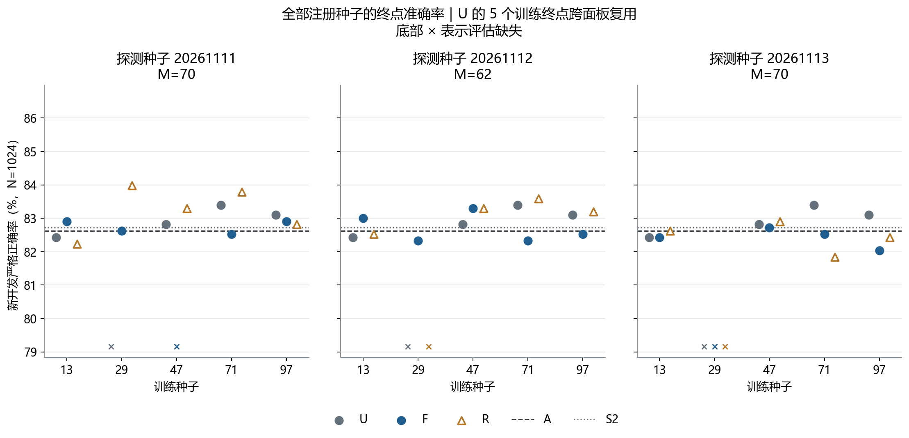
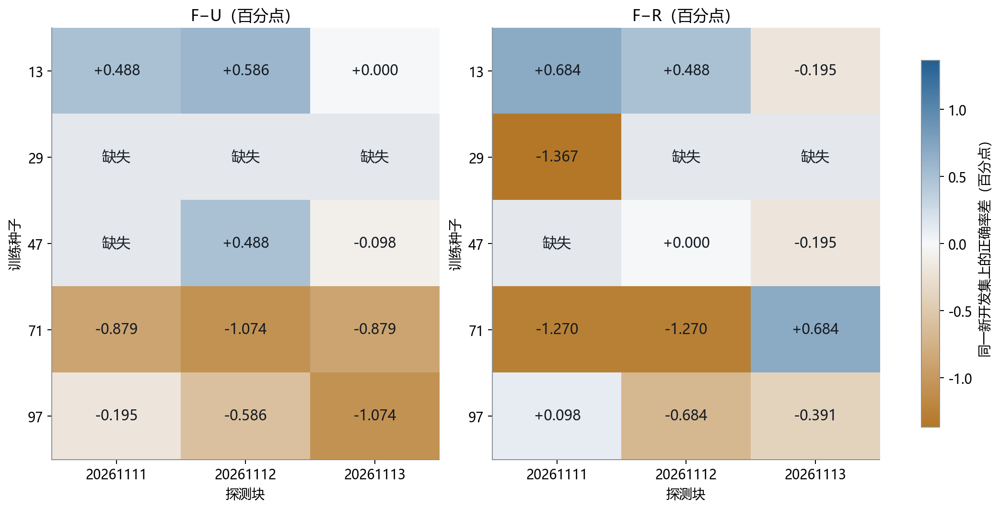
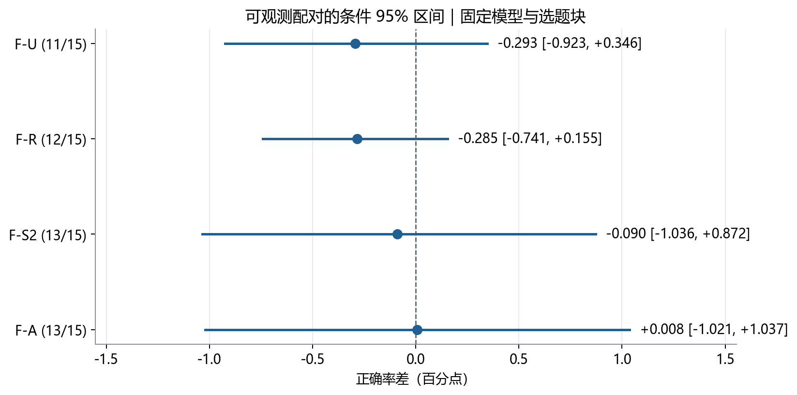
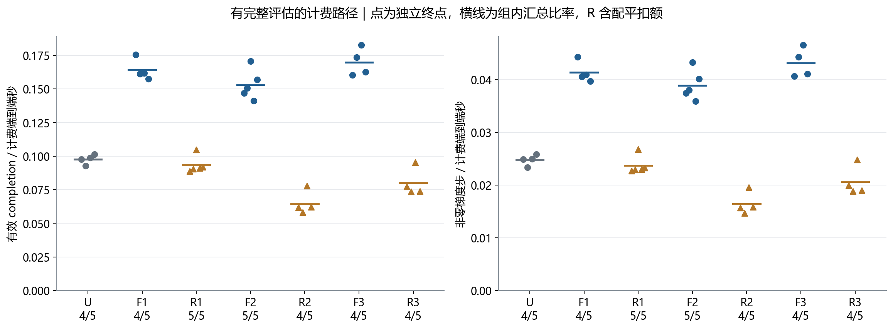
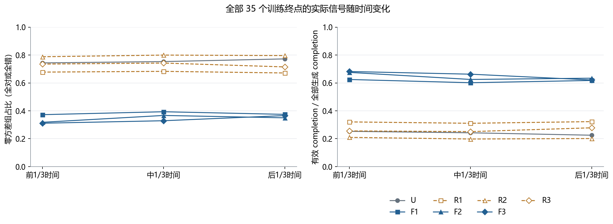
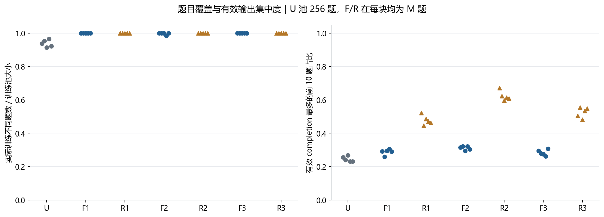
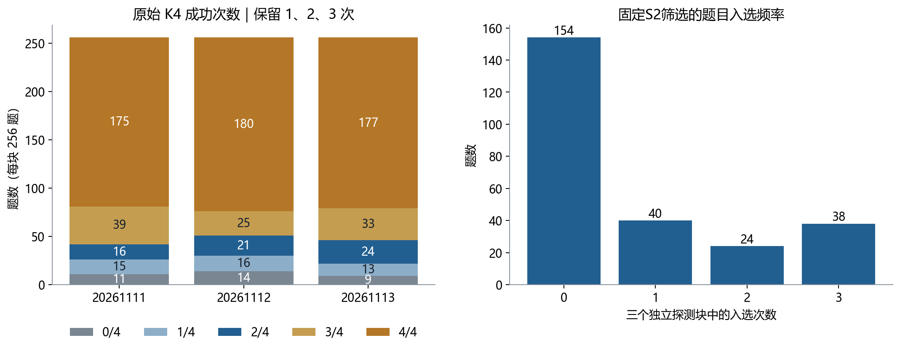
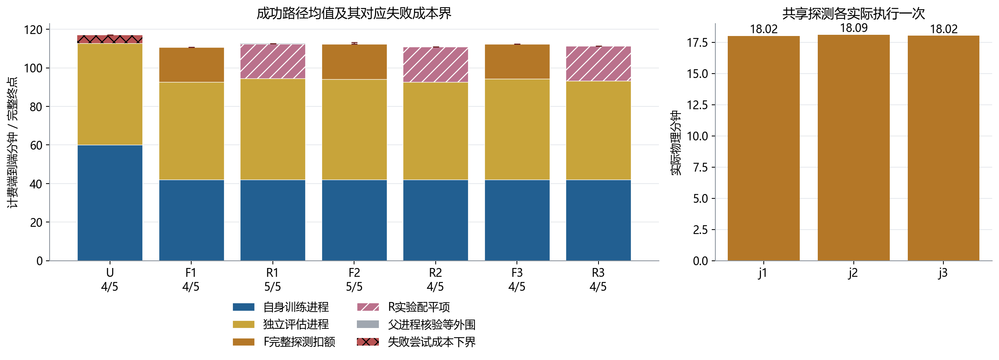

# 256 题固定预筛复验与同规模随机子集消融

本地家族 `desktopfilterrep_2026-11-10_235416`。35/35 个训练终点已复核，32/37 个对象完成同一批 1024 道新开发题的独立评估。F 为固定 S2/K4 预筛，U 为完整训练池均匀采样，R 为同规模随机子集。

**在端到端记录齐全的 3 个训练种子整块中，F 的有效 completion/计费端到端秒相对 U 变化 +65.06%。新开发准确率 F−U 在 11/15 个可观测配对中平均 -0.293pp，固定模型和种子的条件 95% 区间为 [-0.923, +0.346] pp。** 5 个对象因运行故障耗尽重试，原定完整矩阵的准确率和端到端工程阈值无法判定。

F−R 在 12/15 个可观测配对中平均 -0.285pp，条件区间 [-0.741, +0.155] pp。F−S2 为 -0.090pp，F−公开模型 A 为 +0.008pp。可用配对中，F 对同规模 R 或起点 S2 的准确率优势均缺少证据。 [比较与区间](paired_differences.csv)

35 条计费训练路径汇总后，F 的有效 completion/秒比 U 变化 **+56.08%**。三个探测块相对同批 U 的训练口径分别为 +59.65%、+44.37%、+64.21%。这些值包含完整探测扣额，适用于已完成训练的信号分析。完整评估的端到端效率和缺失范围另见下文。 [信号与成本](endpoints.csv)

新开发集来自 GSM8K 官方 train 的后置隔离子集。项目记录未显示这些题被曝光，公开模型预训练是否见过仍未知。GSM8K 正式 test 和 SVAMP 保持封存。

## 全部种子和失败对象

A 为 846/1024（82.617%），共同 S2 为 847/1024（82.715%）。两者使用冻结权重。新开发集首次开启前已锁定 35 个训练终点和这两个锚点。 [权重锁](../../../experiments/desktopfilterrep_2026-11-10_235416/all_training_endpoints_fixed.json)

|正确数，每份分母 1024|13|29|47|71|97|完整评估|
|---|---|---|---|---|---|---|
|U|844|缺失|848|854|851|4/5|
|F / 20261111|849|846|缺失|845|849|4/5|
|R / 20261111|842|860|853|858|848|5/5|
|F / 20261112|850|843|853|843|845|5/5|
|R / 20261112|845|缺失|853|856|852|4/5|
|F / 20261113|844|缺失|847|845|840|4/5|
|R / 20261113|846|缺失|849|838|844|4/5|

|评估对象|尝试次数|失败标签|结果|
|---|---|---|---|
|F-j20261111-s47|2|eval-F-j20261111-s47-a0 / eval-F-j20261111-s47-a1|缺失|
|F-j20261113-s29|2|eval-F-j20261113-s29-a0 / eval-F-j20261113-s29-a1|缺失|
|R-j20261113-s29|2|eval-R-j20261113-s29-a0 / eval-R-j20261113-s29-a1|缺失|
|R-j20261112-s29|2|eval-R-j20261112-s29-a0 / eval-R-j20261112-s29-a1|缺失|
|U-s29|2|eval-U-s29-a0 / eval-U-s29-a1|缺失|

这 5 个缺口保留原始失败日志、退出码和已写出的部分行。完整预测与部分预测在评估账本中分别登记。11 月 13 日发生原生评估进程异常和后续 HIP 错误，当时 Windows 无法枚举 RX 9070 XT。根因仍未确认。用户清理并重装驱动后，旧开发 64 题的 S2 输出与原文件 SHA256 一致。用户曾在已保存终点的边界暂停。11 月 18 日晚从 28 份恢复，按冻结顺序完成最后四项，于北京时间 2026-11-19 02:45:47 保存最后一项。 故障审计 · 重装与暂停记录 · 逐对象尝试 · [任务结束收据](../../../experiments/desktopfilterrep_2026-11-10_235416/all_model_tasks_complete.json)

### F-U 的配对正确率差

|训练种子|20261111|20261112|20261113|
|---|---|---|---|
|13|+0.488pp|+0.586pp|+0.000pp|
|29|缺失|缺失|缺失|
|47|缺失|+0.488pp|-0.098pp|
|71|-0.879pp|-1.074pp|-0.879pp|
|97|-0.195pp|-0.586pp|-1.074pp|

### F-R 的配对正确率差

|训练种子|20261111|20261112|20261113|
|---|---|---|---|
|13|+0.684pp|+0.488pp|-0.195pp|
|29|-1.367pp|缺失|缺失|
|47|缺失|+0.000pp|-0.195pp|
|71|-1.270pp|-1.270pp|+0.684pp|
|97|+0.098pp|-0.684pp|-0.391pp|

## 区间、缺失敏感性与环境变化

|比较|有完整预测的配对|可观测平均差|条件 95% 区间|完整矩阵极值界|
|---|---|---|---|---|
|F-U|11/15|-0.293pp|[-0.923, +0.346] pp|[-14.740, +18.594] pp|
|F-R|12/15|-0.285pp|[-0.741, +0.155] pp|[-13.626, +13.040] pp|
|F-S2|13/15|-0.090pp|[-1.036, +0.872] pp|[-11.107, +2.227] pp|
|F-A|13/15|+0.008pp|[-1.021, +1.037] pp|[-11.009, +2.324] pp|

以 1023 个新开发题近重复簇为抽样单位，使用种子 20261116 对所有已得到的固定模型联合重采样 20000 次。每次在相同簇样本上重算各模型正确率，再求可观测配对的平均差。每个训练种子的共同 U 在三个选择块中共享同一次抽样结果。训练和探测种子固定，且只有一个候选池。完整矩阵极值界允许每个缺失模型的正确率在 0 到 100% 间变化，按其在 15 格的实际权重计算，反映缺失可导致的最大幅度。原定完整矩阵保留为缺失，本次未计算交叉 bootstrap。 缺失分析口径 · 联合重采样数组

|比较|种子类型|种子|配对数|平均差|最小与最大|描述性 SD|
|---|---|---|---|---|---|---|
|F-U|探测|20261111|3|-0.195pp|[-0.879, +0.488] pp|0.684 pp|
|F-U|探测|20261112|4|-0.146pp|[-1.074, +0.586] pp|0.815 pp|
|F-U|探测|20261113|4|-0.513pp|[-1.074, +0.000] pp|0.543 pp|
|F-U|训练|13|3|+0.358pp|[+0.000, +0.586] pp|0.314 pp|
|F-U|训练|29|0|缺失|缺失|—|
|F-U|训练|47|2|+0.195pp|[-0.098, +0.488] pp|0.414 pp|
|F-U|训练|71|3|-0.944pp|[-1.074, -0.879] pp|0.113 pp|
|F-U|训练|97|3|-0.618pp|[-1.074, -0.195] pp|0.440 pp|
|F-R|探测|20261111|4|-0.464pp|[-1.367, +0.684] pp|1.016 pp|
|F-R|探测|20261112|4|-0.366pp|[-1.270, +0.488] pp|0.770 pp|
|F-R|探测|20261113|4|-0.024pp|[-0.391, +0.684] pp|0.481 pp|
|F-R|训练|13|3|+0.326pp|[-0.195, +0.684] pp|0.462 pp|
|F-R|训练|29|1|-1.367pp|[-1.367, -1.367] pp|—|
|F-R|训练|47|2|-0.098pp|[-0.195, +0.000] pp|0.138 pp|
|F-R|训练|71|3|-0.618pp|[-1.270, +0.684] pp|1.128 pp|
|F-R|训练|97|3|-0.326pp|[-0.684, +0.098] pp|0.395 pp|

F−U 的 11 个可观测配对中，3 个为正、7 个为负、1 个持平。训练种子 13 和 47 的可观测均差为正，71 和 97 为负，种子 29 无完整 F/U 配对。三个探测块的 F−U 均差均为负。少量种子及单一候选池限制了跨运行推断。

|比较|评估驱动|配对数|平均差|
|---|---|---|---|
|F-U|同版本|11|-0.293pp|
|F-U|跨版本|0|缺失|
|F-R|同版本|12|-0.285pp|
|F-R|跨版本|0|缺失|
|F-S2|同版本|8|-0.110pp|
|F-S2|跨版本|5|-0.059pp|
|F-A|同版本|8|-0.012pp|
|F-A|跨版本|5|+0.039pp|

完整预测按驱动登记为 32.0.32015.12012 共 22 份、32.0.32015.16001 共 10 份。驱动版本与实际评估顺序及种子重合。同版本子集是敏感性检查，无法独立识别驱动影响。旧 64 题重放的结果仅覆盖共同 S2 和该检查用集合。 [端点与驱动](endpoints.csv) · 驱动分段记录

## 共同 S2 上的新增判对与回归

|方法|完整终点|S2 正确→错误平均题数|S2 错误→正确平均题数|净正确数变化|
|---|---|---|---|---|
|U|4|21.75|24.00|2.25|
|F|13|25.38|24.46|-0.92|
|R|13|26.62|29.15|2.54|

同一批可观测 F/U 配对中，F−U 的 -0.293pp 可拆为新增判对差 +0.027pp 和少回归贡献 -0.320pp。F 的新增判对数接近 U，回归题略多。F−S2 的条件区间包含零，未观察到明确的净能力增长。缺失对象无转移记录。 逐题转移 ID · [逐配对分解](paired_s2_transition_decomposition.csv)

## 实际梯度信号、覆盖与训练时间窗

|方法|训练终点|优化步|零方差组|有效 completion|有效 completion/计费训练秒|非零梯度步|非零梯度步/计费训练秒|
|---|---|---|---|---|---|---|---|
|U|5|3724|75.67%|3573|0.19825|906|0.05027|
|F|15|6558|35.39%|16734|0.30942|4237|0.07835|
|R|15|7998|73.67%|8268|0.15292|2106|0.03895|

计费训练秒包含自身加载、训练、保存、父进程核验与应计的 F 探测或 R 配平时间。有效 completion 要求实际优势非零且实际 loss mask 非空。核验覆盖逐组奖励、实际优势和掩码、每步梯度有限性、冻结骨干无梯度、Adam 状态以及保存后 LoRA 相对 S2 的参数变化。实际有 10948 个零梯度 Adam 步仍改变了权重。训练峰值 allocated/reserved 为 4.621/10.402 GiB。Adam/RNG 文件供审计，sampler 和 dataloader 的精确续训未验证。 [全部训练诊断](training_diagnostics.json)

|探测种子|比较|有完整计费的配对训练种子|F 有效 completion/秒|对照/秒|F 相对变化|F 非零梯度步/秒|对照/秒|
|---|---|---|---|---|---|---|---|
|20261111|F-U|13/71/97|0.16476|0.09727|+69.39%|0.04150|0.02467|
|20261111|F-R|13/29/71/97|0.16405|0.09055|+81.16%|0.04136|0.02293|
|20261112|F-U|13/47/71/97|0.15623|0.09768|+59.94%|0.03967|0.02474|
|20261112|F-R|13/47/71/97|0.15623|0.06472|+141.40%|0.03967|0.01638|
|20261113|F-U|13/47/71/97|0.16984|0.09768|+73.88%|0.04311|0.02474|
|20261113|F-R|13/47/71/97|0.16984|0.08016|+111.86%|0.04311|0.02066|

七条端到端路径均成功的训练种子为 13、71、97。在这些整块内，U、F、R 的有效 completion/计费端到端秒分别为 0.09727、0.16055、0.07533，F 相对 R 变化 +113.13%。F 的非零梯度步/计费端到端秒相对 U 变化 +64.72%。上表按每个探测块各自可配对的种子计算。缺失评估的端到端时间保留空值。 [逐端点成本与信号](endpoints.csv)

|方法|时间窗|组数|全对|全错|混合|有效 completion 比例|
|---|---|---|---|---|---|---|
|U|前|1198|69.03%|5.34%|25.63%|25.29%|
|U|中|1256|69.43%|5.89%|24.68%|24.24%|
|U|后|1270|73.31%|3.94%|22.76%|22.50%|
|F|前|2216|25.59%|7.90%|66.52%|65.97%|
|F|中|2202|27.16%|9.17%|63.67%|62.95%|
|F|后|2140|28.04%|8.36%|63.60%|62.39%|
|R|前|2711|67.17%|6.49%|26.34%|25.89%|
|R|中|2656|67.81%|6.55%|25.64%|25.13%|
|R|后|2631|67.20%|5.78%|27.02%|26.52%|

窗口按每个终点的实际训练时长三等分，按组完成时间归属，汇总比例以实际组数为分母。F 的有效比例从 65.97% 降到 62.39%，后段仍高于 U 的 22.50% 和 R 的 26.52%。在本轮实际训练时长内，未见 F 信号枯竭。

|方法|单个终点实际覆盖题数|单个终点前十题的有效输出占比|
|---|---|---|
|U|234–247|23.06%–26.87%|
|F|61–70|25.89%–32.17%|
|R|62–70|44.57%–67.22%|

F 与 R 基本采遍各自的训练子集，F 的有效输出比同规模 R 更分散。逐终点表记录实际生成长度与 token、解析和格式失败、截断、覆盖题数及重复次数。 [时间窗](training_signal_windows.csv) · 逐题覆盖

## 三次探测与数据隔离

|探测种子|0 / 1 / 2 / 3 / 4 次成功题数|M|完整探测秒|随机种子|F∩R|
|---|---|---|---|---|---|
|20261111|11 / 15 / 16 / 39 / 175|70|1080.95|3101|25|
|20261112|14 / 16 / 21 / 25 / 180|62|1085.68|3102|12|
|20261113|9 / 13 / 24 / 33 / 177|70|1081.02|3103|19|

固定 S2 每题 K=4，只留原始成功次数 1、2、3。R 从共同 256 题无放回抽同一 M，允许与 F 重叠。三个 F 集合两两 Jaccard 依次为 0.467、0.556、0.535。U/F/R 各自固定题池内均匀有放回训练。 原始探测与进程收据 · 逐题集合频率

历史账本核验四个已发布源码和证据归档的 SHA256，逐文件比对并保留不同历史版本。覆盖名义及实际训练、校准、探测、开发评估和留存预测。历史记录有 676 个题目 ID，加上疑义题及近重复簇闭包共排除 902 题，剩余 6571 题。原 validation 512 整批排除。近重复沿用 word(1,2) TF-IDF cosine≥0.90，合并原记录和官方 train 重拟合边并检查归一化完全重复。 历史审计 · 逐题历史账本 · 簇与成员

收尾时从已核验的发布归档恢复原始 GSM8K train 文件，SHA256 与原始 manifest 一致。按官方顺序核查了原 train 与 validation 的题号、题干及参考解。恢复过程只提取训练源文件。 原始训练数据恢复收据

数据抽样种子 20261114 和 20261115 在新探测前登记。Agent 按冻结顺序审核候选题干和参考解，首 283 题中排除 27 题，取首批 256 个合格题。原题、金标、审阅身份与理由均保留，已登记疑义题及关联簇先排除。新开发集按完整簇冻结，隔离于候选池、共同 S2 和历史曝光。专用入口要求权重锁和对象 ID，原划分仍可按原用途使用。 候选审核 · 候选池 · [新开发 manifest](../../../data/fresh_development/desktopfilterrep_2026-11-10_235416/manifest.json)

## 盲化 Agent 审阅

|盲化范围|案例数|
|---|---|
|原定种子 29 的可用配对|247|
|补充同驱动 F/U 配对|91|

审了所列可用配对的所有判对不一致题，并按登记种子每对抽取最多 16 道共同判对和 16 道共同判错题。原定训练种子 29 的 6/9 个比较缺预测，缺口保留。补充种子 13 的固定 F/U 同驱动配对在缺失方案中单列。题目、参考解和回答以匿名标签交给 Agent，473 份唯一原文响应逐份判断并固定注释哈希后解盲。审阅由 Agent 完成，`human_reviewed=false`。相同响应的重复展示保留映射。 [审阅范围、分层计数和冲突](blind_review_summary.json)

|类别|响应展示次数|
|---|---|
|推导支持正确答案|322|
|答案正确但推导不可核验|0|
|读题或建模|263|
|计算|27|
|答案解析|28|
|截断|1|
|推导有误但数值碰巧正确|4|
|无法确定|31|
|其他|0|

|人工智能代理判别|题目 ID|解盲对象|可核查理由|
|---|---|---|---|
|读题或建模|gsm8k-train-00019|S2|通勤往返40英里只算一天，漏乘5个工作日。|
|计算|gsm8k-train-00570|S2|投放总225算对，225−25误为199。|
|答案解析|gsm8k-train-02254|F-j20261111-s13|54张除以3得18且boxed正确，但末尾空####覆盖了boxed。|
|截断|gsm8k-train-02551|U-s13|末尾在重新审题时截断，未给最终作答；前面也把全季分数当末场分数，并以2计算三分球。|
|推导有误但数值碰巧正确|gsm8k-train-00837|S2|给两位遛狗人各算一条腿，得5.5又无理由取5碰到金标。|

上表是按分层抽样后看到的案例。类别计数包含同一响应的重复展示，适用于定位错误类型。未审阅的数值错误不归为计算错误。前期运维界面显示过 S2 聚合正确数及 seed47 的部分题目 ID 和判对标记，匿名语义审阅未读该日志的响应原文。Agent 在已审案例中标出 31 道有疑义或参考解笔误的题，合计 40 条案例标注。主结果沿用冻结评分器和金标。 盲评细节 · 题干或参考答案疑义

## 实际成本与原预算

三次完整探测实测决定 B=3600 秒。旧开发 64 题的独立评估用时 218.60 秒，按 N 线性外推为 3497.63 秒。主训练前登记保守余量，取外推的两倍加 300 秒再向上取整到 300 秒，冻结 E=7500、O=300、C=11400 秒。评估未用额度不回填训练。全会话硬上限 262.83 小时，其中每个单元预留一次完整重试，共 106.06 小时。 [冻结预算](../../../experiments/desktopfilterrep_2026-11-10_235416/protocol_frozen.json) · 评估预留登记

F 每个终点扣完整 P_j，R 的同额扣除服务于相同可训练时间。三次共享探测实际总耗时 54.13 分钟。各终点的 F 探测扣额合计 4.511 小时，R 实验配平合计 4.511 小时。三次 R 抽样实际 CPU 时间合计 0.000122 秒。R 获得完整 B 训练时长的效果需要单独实测。 [探测耗时](probe_summary.csv)

|阶段|模型与运行检查进程数|实际进程时长下界（小时）|上界（小时）|
|---|---|---|---|
|准备、定标和恢复检查|8|0.1663|0.1663|
|共享探测|3|0.9021|0.9021|
|训练含失败|36|26.2667|26.2842|
|新开发评估含失败|43|27.6160|27.6160|

全部尝试的物理进程时长为 **54.951–54.969 小时**，含失败时长 30.62–31.67 分钟。界限来自 U-s47-a0 重启中断时的未知精确退出。评估失败路径另有父进程核验界，U-s47 首次完整成功来自唯一一次重试。注册到统计出表的实际墙钟为 194.87 小时，包含项目内准备、用户暂停、重启和等待。会话硬截止为北京时间 2026-11-21 22:44:17。有完整评估的路径中，成功路径和计入失败成本后的最大 C 超额分别为 0.00 秒和 0.00 秒，训练自然边界最大超额为 8.42 秒。 全部尝试账本 · 失败端点路径界 · 中断成本界

## 实验判断与复算

前瞻开发阈值是完整 F−U 至少 +1 pp 且条件区间下界大于零。工程阈值基于完整端到端信号提高至少 20% 且三个探测块方向均正。完整矩阵的两项决策均因缺失留空。现有配对复现了更多有效训练信号，准确率差在各训练种子间变号，与同规模 R 的条件区间也包含零。可用结果不足以把预筛作为提分手段推进。下一步优先核查探测时成功率和训练奖励为何没有转化为新题上的正确率，以及共同 S2 原本判对的题在哪些情况下回归。另行登记第二独立候选池前，先验证长评估在当前设备上可稳定完成。

上一轮 64 题池的 F−U 为 +1.5625 pp，条件区间也包含零。其端到端有效 completion/秒提高 72.45%。两轮都看到信号效率提高的方向，各自的开发题、池规模和训练预算不同。 [上一轮报告](../desktopfilter_20261110/findings.md)

复算在项目独立环境内运行，使用锁定数据、源码、权重、原始输出及已固定审阅注释。全部 35 个检查点及其他尝试的工件保存在项目内。最终按文件登记 SHA256，正式保留集仍封存。此页提供中文发现与已发布的汇总证据。 [复现命令](../../../docs/REPRODUCING_FILTER_REPLICATION_20261110.md) · [结构化汇总](summary.json) · [证据审计](evidence_audit.json) · 图表检查
