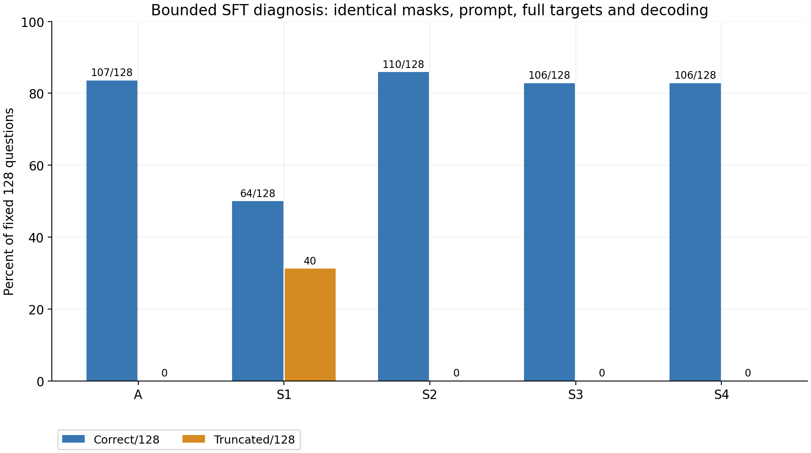
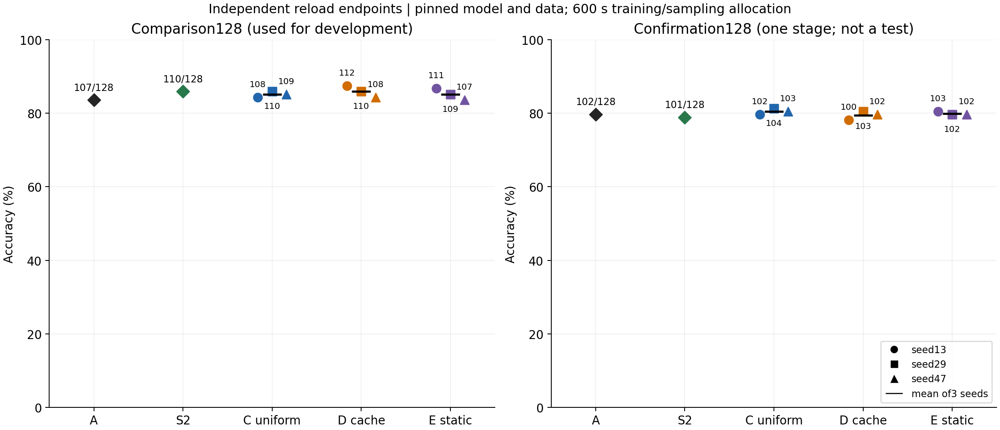
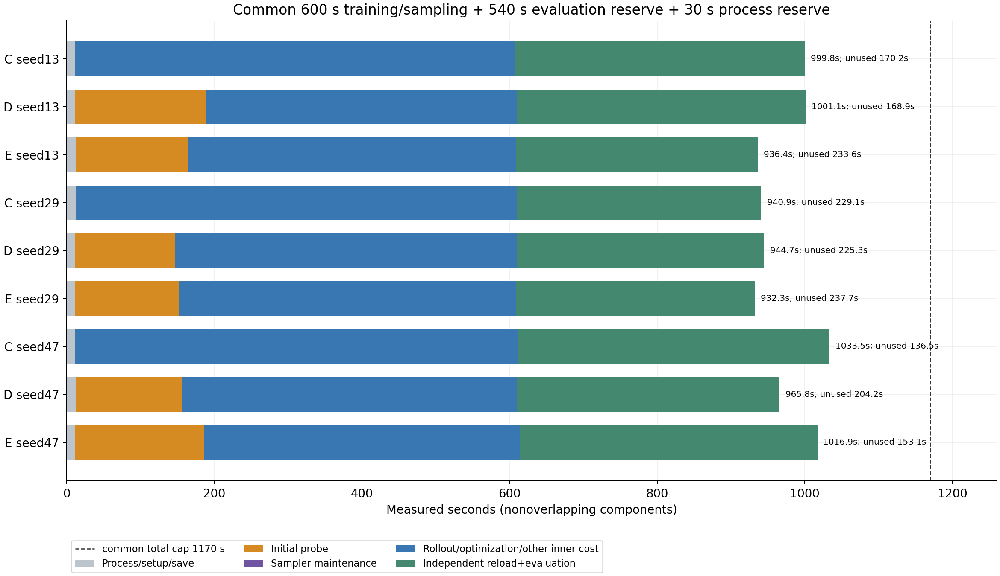
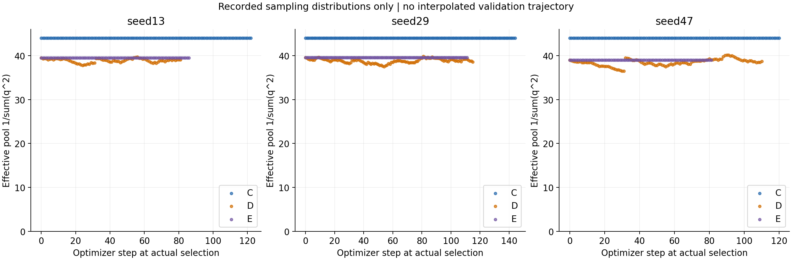

# ReasoningRL Lab：SFT 退化排查与 rollout 缓存采样开发对照

运行家族：`desktoprepair_20261106_152712`。日期：2026-11-06；仅 RX 9070 XT、本地非量化 BF16/SDPA。GSM8K test 和 SVAMP 保持封存。本报告的两个 128 题集合均来自 validation，不能称为正式独立测试。

**主要发现：较强 SFT 的退化可逐字节复现；降低优化强度避免了该明显退化。缓存动态采样确实改变了实际选题分布，但当前开发比较集上没有可靠的增益证据。** A 为 107/128，选中的真实 SFT S2 为 110/128；C/D/E 三种子平均正确数为 109/110/109。D−C 平均仅 +0.78125 个百分点，D 的平均分与共同 S2 起点相同。

状态：本轮全部模型任务已于北京时间 2026-11-06 20:12:10 完整结束；九组训练、两组128题独立重载评测、一次阶段确认均完成。运行上限为北京时间15:27:12–21:27:12，整轮最终墙钟（包含收尾归档）见 [会话账本](../../../experiments/desktoprepair_20261106_152712/session_final.json)。

## 已验证的 SFT 实现与退化因素

先用真实 tokenizer 检查了 128 条训练样本：完整标准解和 EOS 均保留，prompt/padding 的 labels 全部为 −100；第一个 completion label 位于 prompt 长度处，由前一位置 logits 预测，没有再次手工移位。最长/最短样本组成的补齐 batch 有 348 个 padding 位置，全部屏蔽。模型交叉熵与手工 causal shift 交叉熵均为 1.7742661238，差为 0。

Qwen3 的非 thinking chat prefix 在训练与推理中相同，均先闭合 `<think>`。拼接前后 token 序列一致，没有静默截断 gold。128 条标准解的最终数值与数据 manifest 的 answer 一致；这只验证序列化与数值一致性，不证明每条参考推理都无语义问题。

公开模型、未训练 LoRA、保存后独立重载的未训练 LoRA，在旧 32 题上的原始预测完全一致，均为 28/32；logits 最大差为 0。未训练控制的 checkpoint stage 明确为 `untrained_lora_control`，没有冒充 SFT。四个真实 SFT 终点也都通过独立加载 logits 检查，最大差为 0，并分别在新进程评测。

候选在运行前限制为四个，未追加搜索。比较集、选择门槛与排序规则先登记在 [SFT 预登记](../../../experiments/desktoprepair_20261106_152712/sft_preregistration.json)。仅比较集用于候选选择，旧 32 题不参与选择。

|候选|学习率 / 更新步数|名义池 / 实际监督题数|实际监督 token|正确 /128|截断 /128|解析失败 /128|LoRA 改变量 L2|
|---|---:|---:|---:|---:|---:|---:|---:|
|A|未额外训练|—|—|107|0|2|—|
|S1|1e-4 /32|128 /128|15,160|64|40|43|2.587050|
|S2|1e-5 /8|128 /32|3,688|110|0|2|0.069673|
|S3|1e-5 /32|128 /128|15,160|106|0|6|0.328555|
|S4|3e-5 /16|128 /64|7,775|106|0|4|0.451577|

S2、S4 满足“正确数至少 A−2、截断与解析失败分别不超过 A+2、梯度有限且权重更新”的预登记门槛，S2 按最高正确数选中。四个候选的 SFT 核心函数 AST 哈希相同；其余源码演进及各运行快照单独保留。[精确监督与结果表](sft_candidates.csv)、[实现指纹与配对归因](sft_attribution.json)。

S1 的 `adapter_model.safetensors` 与历史 `desktoprocm10pilot_20261105-B` **SHA256 完全相同**：`9f72b38dec4ad9745b0eb27d8e70c219c08eaf5895d67ab5d1e4b9d5713e0e18`。旧 32 题的原始预测也逐条相同，仍为 16/32、9 次截断、10 次解析失败。历史负面结果没有被替换。

同为 32 步、128 条完整样本、15,160 个监督 token，S1→S3 仅把学习率降低十倍，正确数从 64 增至 106，截断从 40 降至 0。这是在本固定设置下支持“优化强度是退化干预因素”的直接对照；不是从 loss 下降推断能力改善。检查过的边界、mask、EOS 和重载缺陷没有被观察到。**重复生成背后的内部机制仍未确认**，不能进一步断言已定位为过拟合、某个 EOS 参数或驱动问题。

S1 相对 A 损失 48 题、修复 5 题，净少 43 题。48 个回归例按互斥表面状态拆分为：30 个截断、4 个未截断但解析失败、14 个未截断且数值错误。这个拆分解释计数，不把截断当成已证实的全部因果机制。重复标签与这些状态有重叠，不能相加。

Agent 样例审阅发现：有的输出已经算对 812 或 50，却重复至上限；有的把 `####` 放在开头，随后混入多个数；也有真实条件建模错误，如把隔月 400/800 公里交替误读为持续递增、遗漏年龄的两倍关系。S2 新增判对的三个 A 输出原本都可解析但数值错误，涉及采购成本遗漏、补水的参考容量、接力桌间距解释；不能把这三题简单归因于解析器修复。桌间距题的起点解释空间也已记录，没有改金标或删题。[原始样例](sft_case_review.jsonl)、[Agent 审阅说明](agent_case_notes.json)均明确 `human_reviewed=false`，不冒充人工审核或全量语义归因。

Qwen3-1.7B 本身已后训练。本轮选择 S2 只说明它符合预定开发门槛，三个净增样本与四候选选择不足以证明额外 SFT 的泛化收益。公开 A 直接初始化的独立入口与防冒充检查已实现并单元验证；本轮最终 C/D/E 实际使用真实 S2，没有切换路线，也没有混算历史 B 起点。

## 固定数据、成本定标与采样协议

在本轮任何模型推理前固定了互斥 comparison128、confirmation128，并排除旧 regression32。扫描本地所有历史 `runs/**/predictions.jsonl`，两个新集合均无既有预测记录；旧 32 题已有反复曝光。缺失于当前 checkout 的外部历史无法审计。两个集合仍是开发者已可访问的 validation，不因为缺少既有预测就成为正式独立测试。[固定 ID](../../../experiments/desktoprepair_20261106_152712/development_ids.json)、[既往曝光](../../../experiments/desktoprepair_20261106_152712/prior_exposure.json)。

训练、探测、成功率缓存均只读取 train。SFT 名义池取固定训练序列前 128 题；GRPO 候选从其后取题，并共同排除四个历史已标记的 train 题。初始定标用 64 个候选、排除后 60 题；其余标签没有被宣称已经全量人工审阅。正式保留集没有参与选池、选参数或选检查点。

定标实测：C 的 8 步训练内部阶段为 34.29 秒；D 的 60 题 K=4 全池探测为 253.68 秒，含 12 步训练的内部阶段为 305.59 秒。D 有 4 个非零梯度步骤，LoRA 改变量为 0.015382；D/E 初始探测预测和权重完全相同。三个定标终点也分别独立重载，仅用旧 32 题做链路诊断，不参与模型选择。[定标预登记](../../../experiments/desktoprepair_20261106_152712/calibration_preregistration.json)、[实际成本](../../../experiments/desktoprepair_20261106_152712/calibration_result.json)。

预登记成本规则选择最大的可用池：60 题估计初始探测超过 600 秒预算的 35%，44 题估计约 186.03 秒，满足目标。因此主对照固定为 **48 个候选共同排除 4 题后 44 题**。每组自训练入口开始计 600 秒，包含模型加载、准备、初始探测、训练 rollout、优化和采样维护；自然生成/优化边界后的保存造成小幅超额，照实记录。另预留 540 秒独立重载评测与 30 秒进程外围费用，得到共同端到端上限 **1,170 秒**。540 秒由 A 与四个 SFT 候选中最慢的 128 题实测评测向上取整再加 60 秒确定；没有根据 C/D/E 成绩调整。

本轮没有重复的训练内验证，主要终点均由新进程独立加载后生成。评测未花完的保守预留不回填训练，避免看过终点后继续训练；因此共同上限不等于实际耗时完全相等。C 没有初始探测，可以在共同 600 秒里完成更多优化。

唯一改进主线为 **`rollout_cache_fifo_v1_dynamic`**：

1. D/E 各自付费执行相同的全池 K=4 初始探测，成对种子的原始预测及初始权重必须相同。探测使用独立且恢复的 torch RNG。
2. 题目缓存保存实际有序的初始观测及随后已生成的训练 rollout 二值奖励，最多最近 16 次；`p_i=(成功数+0.5)/(缓存次数+1)`。
3. `g_i=4p_i(1−p_i)`，`q_i=0.25/N+0.75*g_i/Σg_j`。每次实际训练 rollout 组结束后更新相应题的 FIFO，**不额外生成后续全池探测**。
4. 距离某题最近一次观测满 32 个 optimizer step 时清空其缓存、回到 `p=0.5`。这是“距最近观测”的时效，不是逐条奖励都带独立过期时间。年龄检查在实际选题/更新边界执行。
5. E 永久固定初始权重，关闭后续缓存更新和过期；C 均匀有放回采样。0.25/N 概率下界与过期回归先验保证持续被选的机会，不保证有限时间内逐题全覆盖。

缓存的有限样本成功率是有噪声、随模型变化的代理，不是校准过的能力概率。零方差组也会产生可用于估计的真实奖励，但不一定产生策略梯度。年龄检查、权重计算、缓存/采样记录与维护全部在共同时间钟内，另有嵌套维护计量。C/D/E 共享真实 S2 哈希、44 题池、奖励、损失、生成和优化参数，仅采样机制及必要成本不同。seed13/29/47 成对运行，D/E 三对初始预测及权重均已核对一致。[冻结协议](../../../experiments/desktoprepair_20261106_152712/sampling_frozen.json)、[成对初始化核验](../../../experiments/desktoprepair_20261106_152712/paired_initialization_checks.json)。

没有在新协议下补跑原“周期全池动态”基线，因此**不声称本策略在模型效果或端到端效率上优于该原策略**。历史探测占比只解释本轮工程方向，不能充当新协议的同预算基线。

## 三种子共同终点

下表全部使用 comparison128、greedy、512 个新 token 上限、同一评分器，分母均为 128。

|seed|C 均匀正确数|D 缓存动态正确数|E 静态正确数|C / D / E 完成优化步|
|---|---:|---:|---:|---:|
|13|108|112|111|123 /82 /87|
|29|110|110|109|145 /116 /112|
|47|109|108|107|121 /111 /82|
|均值|85.156%|85.938%|85.156%|—|
|种子样本标准差|0.781pp|1.563pp|1.563pp|—|

D−C 的配对差为 +3.125、0、−0.78125pp，均值 +0.78125pp。D−E 的三个差值均为 +0.78125pp，但“差值的种子标准差为 0”不代表效果无不确定性。同题配对、对三个固定种子联合重采样题目的描述性 95% bootstrap 区间，D−C 为 [−1.302, 2.865]pp，D−E 为 [−1.042, 2.865]pp。该区间仅表示这些固定种子下的题目重采样，不能替代种子或总体泛化不确定性；validation 内相似题也可能违反独立抽样近似。

所有主终点都没有比较集截断，解析失败仍有 0–3/128。额外 GRPO 的 D 平均分恰好与 S2 的 110/128 相同，C/E 低 1 题；不能用训练奖励或真实权重更新代替“能力提高”的结论。

图中左右两组128题均已完成，所有训练终点都由新进程独立重载。只使用真实已完成观测，没有插值验证曲线或补写中间成绩。

## 计算成本与机制证据

|组/seed|初始探测秒|训练与重载评测实际总秒|距共同1170秒上限未用足|非零梯度步/总步|训练选题覆盖|
|---|---:|---:|---:|---:|---:|
|C/13|0|999.75|170.25|31/123|42/44|
|D/13|177.55|1001.09|168.91|21/82|41/44|
|E/13|152.72|936.40|233.60|22/87|32/44|
|C/29|0|940.87|229.13|25/145|40/44|
|D/29|135.09|944.66|225.34|30/116|43/44|
|E/29|140.63|932.32|237.68|28/112|41/44|
|C/47|0|1033.49|136.51|26/121|41/44|
|D/47|144.86|965.82|204.18|32/111|42/44|
|E/47|175.49|1016.93|153.07|29/82|36/44|

九组训练子进程合计 5,490.51 秒，独立重载比较评测另计 3,280.83 秒。初始探测嵌套合计 926.33 秒；全体采样器维护嵌套合计约 0.656 秒（包括 C 选题、D 更新、E 选题等），不能再次加到训练时间。这个维护字段不包含所有日志调用的细碎费用，未单独归类的部分仍包含在总时间内。完整分项与 token/显存见 [逐终点账本](standalone_endpoints.csv)；[逐阶段进程成本](../../../experiments/desktoprepair_20261106_152712/process_costs.jsonl)包含 SFT、诊断、定标和阶段确认，整轮墙钟另在最终会话账本记录。

实际内部 600 秒钟有自然边界超额，保存及进程启动另有费用；端到端 1170 秒上限没有超额，实际未用足 136.51–237.68 秒，主要来自保守的独立评测预留。不能把 600 秒、1170 秒或裸 Trainer 的计划吞吐当成真实计算量。GPU event elapsed 含设备等待，不等于活跃 kernel 时间或 FLOPs。

D/E 初始预测相同，但成对初始探测耗时仍不同，例如 seed13 为 177.55/152.72 秒、seed47 为 144.86/175.49 秒。本机没有全程锁定时钟或采集完整后台 GPU/温度轨迹，不能确认吞吐波动原因。实际开销已分别计入各臂；这也限制了从小差异推断稳定效率优势。

九组共完成 979 次优化，244 次有非零梯度，全部梯度检查有限且冻结骨干无梯度；九个适配器都真实改变。GRPO阶段的进程峰值allocated为4.24–4.61GiB，reserved为5.94–8.03GiB，不是系统总显存占用。训练组内零方差率约 64.6%–82.8%，信号仍稀疏。C/29 有 4/580 个训练 completion 截断，其余主训练为 0；评测比较集全部为 0。二值奖励的零方差、截断 loss mask 与 Adam 更新的存在需要分开解释。按策略累计非零梯度步骤，C/D/E为82/83/79，虽然C完成更多optimizer step，非零学习步骤并没有相应更多；D与E也没有清晰的信号数量优势。该诊断不能替代端点结果或相同步数消融。

三个 D 分别完成 82/116/111 次训练 rollout 缓存更新；E 后续为 0。D/E 各有 1 次完整初始全池探测，后续完整全池刷新均为 0、未完成探测也为 0——这是已冻结的缓存策略，不把缓存更新冒称全池刷新。实际使用分布的平均有效池大小：D 为 38.87/38.82/38.48，E 为 39.47/39.57/39.00，C 为 44。D 的覆盖不保证逐题全到达；初始探测全覆盖与优化选题覆盖也不能混为一谈。[逐题曝光](item_exposure.csv)、[实际选题分布观测点](observed_sampler_points.csv)。

分布图的横轴是实际 optimizer step，展示机制执行，不是同预算验证准确率曲线。所有点来自真实选题边界。权重与奖励均可逐步重放；权重改变证明机制生效，不证明采样概率是正确难度或模型效果提高。

## 阶段确认与当前边界

确认集在九个主checkpoint全部固定后才按预登记开启；包括A、S2与九个C/D/E，所有终点独立加载。[开启前清单](../../../experiments/desktoprepair_20261106_152712/confirmation_opened.json)。此阶段没有再选择参数、种子或检查点。

|组别 / seed|13|29|47|均值±种子样本标准差|
|---|---:|---:|---:|---:|
|C|102/128|104/128|103/128|80.469% ±0.781pp|
|D|100/128|103/128|102/128|79.427% ±1.193pp|
|E|103/128|102/128|102/128|79.948% ±0.451pp|

A=102/128（79.688%），S2=101/128（78.906%）。S2相对A为-0.781pp，比较集的三题优势没有在确认集复现，不能强求已后训练模型额外SFT必须改善。

确认集D−C的三个配对差为-1.562, -0.781, -0.781pp，均值-1.042pp；同题条件bootstrap95%区间[-2.865, 0.521]pp。D−E均值-0.521pp。比较集D−C为+0.781pp，确认集的结果必须与其分开解释，不挑选更有利的一个集合当结论。

三个固定种子的逐题配对中，C对而D错合计9次，D对而C错5次。回归项互斥分为：7次未截断且数值错、1次未截断解析失败、1次截断。因此差异不能仅归为终止或解析问题。这里是同128题跨3种子的384个相关配对，不是384个独立问题；数值错不能自动标成算术错。[逐题误差账本](grpo_error_attribution.json)与[待语义审阅样例](grpo_confirmation_case_pack.jsonl)保留原始输出。

SFT保住比较集表现与采样机制真实执行均已验证；是否带来稳定的额外能力收益，当前证据不足。缓存成功率、选题覆盖和稀疏梯度是机制诊断，不是独立泛化指标。确认结果保持负面或中性也不触发追加搜索。

工程上已经具备在此机执行带成本计量的真实受控开发实验的条件。仍没有冻结最终正式协议、具体最终端点与 GSM8K test/SVAMP 单次评测预算，不能启封保留集或宣称泛化提升。44 题训练池、有限成功率缓存、稀疏梯度与三种子结果的稳定性都限制了外推；进入正式验证不要求先在开发集调到正收益；当前欠缺的是具体正式协议、端点与预算冻结，而不是必须发现正结果。44题小池与吞吐波动应作为正式方案的范围选择和局限记录，不能通过继续看确认集来优化参数。

## 来源、证据与复现入口

- 共同真实 S2：`checkpoints/desktoprepair_20261106_152712-S2`，checkpoint SHA256 `e8da01dae86ea2d7a95e19a645440510ec7dce2e4ceb546b26b3ff2dc9ac0bff`。
- 冻结的 `src+configs` SHA256：`8f2578aae3bb03fe0eed6fa65adf326297da1b7e9a3c9002547f4e31362f3373`。完整冻结执行文件逐项摘要见 [源码清单](../../../experiments/desktoprepair_20261106_152712/frozen_source_manifest.json)；每个 run 另存当时源码快照。
- 公开 Qwen3-1.7B 已后训练、非 Base，revision `70d244cc86ccca08cf5af4e1e306ecf908b1ad5e`。本轮重哈希全部 11 个本地模型/tokenizer 文件，与此前官方 LFS/Git 核验收据一致。[当前公开模型核验](../../../experiments/desktoprepair_20261106_152712/public_model_verification.json)。
- GSM8K 来源 revision `3101c7d5072418e28b9008a6636bde82a006892c`，官方 train 经预先近重复簇隔离为 train6961/validation512。数据、许可与内容哈希见 [data manifest](../../../data/manifest.json)；模型预训练污染未知。
- 原始逐题输出分布在 `runs/desktoprepair_20261106_152712-*/validation/predictions.jsonl`，训练 rollout、初始探测、选择、缓存、梯度与成本保留在各训练 run。统一汇总见 [主比较与确认逐题预测](all_endpoint_predictions.csv)、[结构化汇总](summary.json)。
- 当前工程 47 项测试通过，项目 uv 检查 69 个已安装包兼容。原环境复用，无全局依赖、系统驱动或其他项目变更。恢复过程中的沙箱 DNS/CIM、连接器404、pip 模块缺失及替代核验均保存在 [恢复事件](../../../experiments/desktoprepair_20261106_152712/recovery_incidents.jsonl)，没有伪装成训练成功。
- 云 GPU 与付费 API 未使用；本机能耗未计量。LoRA 与 trainer state JSON 不包含可精确续训的完整优化器状态。

本轮49份运行完成 [证据终审](evidence_audit.json)，所有新训练终点、未训练控制和一次阶段确认均保留。[复现命令](../../../docs/REPRODUCING_REPAIR_20261106.md)、[失败/偏差记录](failures_and_deviations.json) 与 [待提交/归档清单](pending_artifacts.md) 一并交接。历史运行、旧配置和负面结果保留，不与本轮均值混算。
